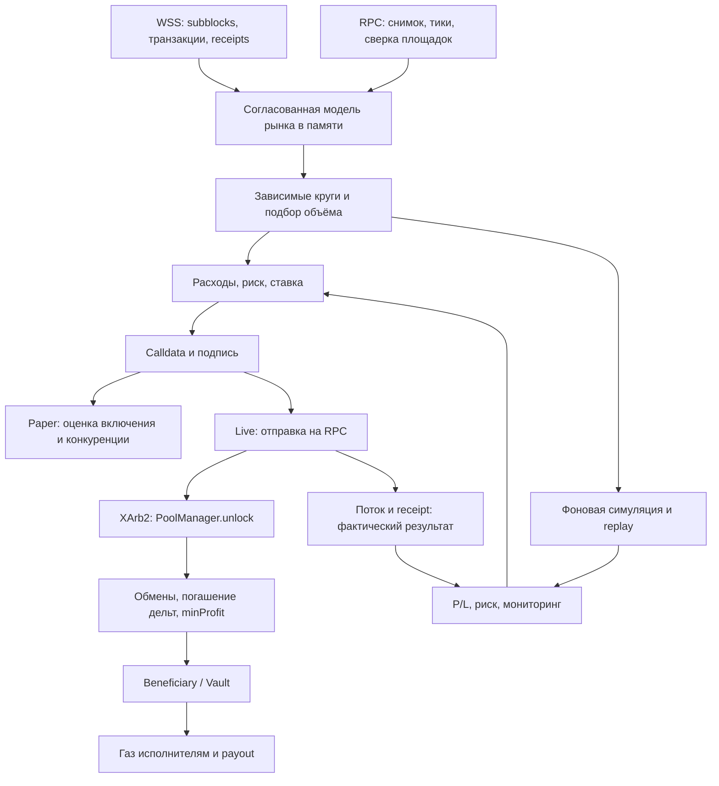

# Arbitr на X Layer и перенос на Ink

Дата исследования: 22 октября 2026. Проверенная версия Arbitr: `7b3ee78bed6d3620f00163b73dbbbe7bcc26ee69`, ветка `claude/project-thread-w1eq08`.

## 1. Вывод и границы подтверждения

**Перенести архитектуру Arbitr на Ink технически реалистично. Перенос доходности требует нового исследования рынка.** Основная ценность проекта — согласованная цепочка «быстрый поток → модель рынка в памяти → поиск → подпись → атомарное исполнение → проверка реального результата». Однако работающая стратегия X Layer сильно зависит от BinaryFi, Caliber, конкретных токенов и конкурентов.

Для Ink официальные источники подтверждают chain ID `57073`, оплату газа в ETH, блоки по 1 секунде, поток subblocks примерно раз в 200 мс и deployment Uniswap v4 PoolManager. В официальной таблице Uniswap адрес PoolManager на Ink **совпадает** с X Layer: `0x360e68faccca8ca495c1b759fd9eee466db9fb32`. Это хороший исходный вариант финансирования атомарных кругов; заменять его Aave заранее нет оснований.

Вместе с тем наличие адреса в deployment-таблице не доказывает текущие балансы PoolManager, его пригодность для нужного размера займа, ликвидность торговых маршрутов или прибыльность работы. Эти пункты проверяются RPC-запросами и fork-тестами.

Статусы доказательств в этом документе:

- **Код** — поведение прочитанной версии Arbitr или официального исходного кода протокола.
- **Документация** — опубликованные сведения Ink/Uniswap/Velodrome; не заменяют проверку текущего состояния сети.
- **История проекта** — сохранённые отчёты и исследования Arbitr; их данные не перепроверялись здесь по живой сети.
- **Предложение** — рекомендуемое устройство переноса, ещё не реализованное и не протестированное на Ink.

В этой среде ранее прошли 94 теста бота и 27 тестов монитора. Полный offline replay записи обработал 1 694 флешблока и построил/подписал 89 бумажных решений. Это подтверждает работоспособность соответствующего Python-пути на записи X Layer; не является проверкой исполнения на Ink или текущей прибыльности на X Layer.

Прямые HTTPS-запросы к `rpc-gel.inkonchain.com` и `rpc-qnd.inkonchain.com`, включая `eth_chainId`, остановлены прокси с `403 Forbidden` при CONNECT. Сайт документации Ink также недоступен через этот маршрут; официальные исходники документации доступны через GitHub. Живой WSS-поток Ink, состояние контрактов, текущие комиссии и пулы не проверены. Отдельного разрешения на торговлю, deployment или переводы этот анализ не предполагает; такие операции не выполнялись. Исходники обоих выбранных репозиториев не изменялись.

`INCYArb` сейчас представляет собой пустой checkout без первого коммита. В нём нет уже готовой реализации, которую можно было бы считать началом переноса.

## 2. Что именно делает Arbitr

Arbitr — бот внутрисетевого атомарного арбитража. Он возвращается в тот же стартовый токен за одну транзакцию. Это не CEX–DEX арбитраж, не межсетевой арбитраж и не стратегия с ожиданием обратного моста.

Пример формы маршрута, без утверждения, что он прибылен сейчас:

`USD₮0 → USDG через v4 → токенизированный актив через v3 → USD₮0 через BinaryFi`.

Либо:

`USD₮0 → актив через BinaryFi → USD₮0 через Caliber`.

Торговый объём предоставляется внутри транзакции PoolManager Uniswap v4. Собственные средства нужны на газ, инфраструктуру и первоначальный запас газа исполнителей. Если круг не возвращает необходимую сумму или не выполняет проверку `minProfit`, транзакция откатывается. Газ за откат остаётся расходом. Защита атомарностью не означает нулевой риск ошибок реализации, неверных полномочий, инфраструктуры или разрешённых внешних контрактов.

Разделение компонентов:



| Компонент | Файлы | Ответственность |
|---|---|---|
| Параметры сети | `bot/xarb_bot/chain.py`, `config.py` | Chain ID, адреса, события, режимы, лимиты |
| Входные данные | `flashblocks.py`, `rpc.py` | WSS-диффы, сырые транзакции, квитанции, RPC |
| Модель пулов | `pools.py`, `v3math.py` | v2, v3, v4, целочисленные котировки |
| Оракульные площадки | `venues.py` | Лестницы BinaryFi, сетки и цены Caliber |
| Граф и подбор объёма | `routes.py`, `engine.py:Market` | Рёбра, циклы, зависимости, отсев и оптимизация |
| Решения и отправка | `engine.py:Engine`, `sender.py` | Риск, ставка, calldata, подпись, nonce, отправка |
| Проверка модели | `xarb.py`, `replay.py`, `legstate.py`, `data/Replay.sol` | Подмена состояния, replay, сравнение ног |
| Исполнение | `contracts/src/XArb.sol`, `XArb2.sol` | Атомарный круг и контроль полномочий |
| Учёт и защита | `risk.py`, `watchers.py`, `paper.py`, `live.py`, `report.py` | Стопы, события, исходы, P/L |
| Деньги после сделки | `XArbVault.sol`, `treasury.py` | Копилка, покупка газа, вывод на payout |
| Эксплуатация | `monitor/`, `ops/vps/`, `.github/workflows/` | systemd, мониторинг, обновления, журналирование |

## 3. Запуск: сначала согласованное состояние

Основной вход — `python -m xarb_bot run`, затем `engine.amain`, `Engine.start`, `Engine.run`.

1. Загружается TOML. Сам по себе `mode = "live"` ещё не включает отправку: нужны одновременно `XARB_LIVE=YES`, адрес контракта и файлы ключей.
2. Создаются RPC-соединения, модель рынка, риск и сторожа. У чтения и отправки отдельные HTTP-сессии; отправка не ждёт очередь фоновых запросов.
3. Для live считываются pending nonce, проверяются код контракта, версия execute, отсутствие паузы и права каждого исполнителя. Проверяются балансы газа.
4. Для paper создаётся случайный одноразовый ключ. Он действительно подписывает транзакции, но `send=False`: так замеряется реальное время подписи без отправки.
5. Готовится симулятор. Без deployment он берёт bundled creation bytecode из `bot/xarb_bot/data/`, получает runtime через вызов создания контракта в `eth_call` и использует state overrides для кода, исполнителя, beneficiary и разрешённых адаптеров. Ничего не разворачивается в сети.
6. **Поток включается до загрузки рынка.** Бот берёт первый флешблок B, ждёт, пока RPC закроет B, и загружает состояние на фиксированном B через `AtBlock`.
7. Находятся и загружаются активы, площадки, пулы, тики. События блока B и более ранние отбрасываются, поскольку уже входят в снимок; последующие применяются по порядку.
8. Строится граф и зависимости кругов. Начинаются поиск и фоновые задачи.

Почему порядок важен: исследование `research/caliber-model/README.md` описывает прежний запуск, при котором загрузка заняла 11 секунд до подписки на поток. Сделки за это время потерялись, и бот видел прибыль в устаревшем состоянии. В текущем коде исправлен именно порядок загрузки, а не просто добавлена задержка.

Если поток или закрытие блока не дождались, есть fallback на pending. Для Ink такой режим нельзя автоматически считать столь же надёжным, как снимок на конкретном блоке: необходима отдельная проверка согласованности.

## 4. Данные X Layer и состояние в памяти

### 4.1. Поток

`flashblocks.stream` читает `wss://xlayerws.okx.com/flashblocks`, переподключается после ошибок и кладёт сообщения в очередь. Parser ожидает:

- `metadata.block_number`;
- `index` флешблока;
- сырые транзакции в `diff.transactions`;
- квитанции, индексированные хешем, в `metadata.receipts`;
- заголовок `base` в первом сообщении, включая base fee и timestamp.

Из RLP извлекаются тип транзакции, calldata, получатель, gas price и эффективная priority fee. Поддерживаются legacy, типы 1, 2, 4; системный `0x7e` не декодируется как обычная подписанная транзакция. Хеш вычисляется из сырых байтов. Восстановление отправителя вынесено из основного пути, когда возможно.

В `Engine._consume` накопившиеся сообщения забираются пачкой. **Состояние обновляется по каждому сообщению, поиск выполняется по последнему.** Это позволяет догонять поток, не теряя промежуточные изменения состояния и не торгуя по заведомо старому сигналу.

### 4.2. Пулы

Для v3 загружаются `slot0`, liquidity, fee, tick spacing, токены, bitmap и liquidityNet вокруг текущего тика. Математика `v3math.py` повторяет целочисленные формулы TickMath/SqrtPriceMath/SwapMath для exact input с направленными округлениями.

Для v4 состояния читаются через `PoolManager.extsload`; в коде зафиксирована раскладка хранения стандартного v4. Есть раздельный учёт LP fee и направленной protocol fee. Пул идентифицируется хешем `PoolKey`: currency0, currency1, fee, tickSpacing, hooks.

Для v2 используется constant product с фиксированной для экземпляра комиссией `fee_bps` и резервами r0/r1.

После первоначального чтения:

- `Swap` обновляет цену, тик и активную ликвидность v3/v4;
- `Mint`/`Burn` изменяют liquidityNet на границах диапазона v3;
- `ModifyLiquidity` делает это для v4;
- `Sync` обновляет резервы v2.

Котировка, выходящая за загруженный диапазон тиков, возвращает `None`. Бот не экстраполирует ликвидность за неизвестную границу. При приближении цены к краю ставится фоновая перезагрузка.

Фабрики X Layer в `pools.py`: Uniswap v3, OkieSwap v3, PotatoSwap v3; для v2 — Uniswap v2 и PotatoSwap v2. Их адреса и комиссии не являются универсальной конфигурацией для Ink.

### 4.3. BinaryFi

Главная особенность: новая лестница цен берётся из calldata оператора с селектором `0x34f7f748` непосредственно в пришедшем флешблоке.

- Публикация содержит asset ID, mid, число bid/ask уровней и упакованные уровни.
- Уровень занимает 3 байта: 12 бит смещения цены от mid и 12 бит объёма.
- Для моделируемых активов цена выражена в центах, объём — в лотах по 0,1 токена.
- Чужие сделки, согласно исследованиям проекта, не «выедают» опубликованные уровни так, как обычный биржевой стакан. Они меняют склад и доступные лимиты.
- Баланс склада обновляется по `Transfer`. Отдельный sell cap корректируется по изменению склада с запасом.
- Цена имеет TTL в блоках; он читается для каждого актива, fallback — 6 блоков.
- Фоновый `quote()` сверяет обе стороны модели. Сторона, расходящаяся более чем на 0,5%, выключается. Поправки к модели консервативны.
- Прямой роутер и whitelisted адаптер могут иметь разные комиссии. Нельзя заменять вызов адаптера прямым обменом и считать экономику той же.

Здесь уже видна зависимость стратегии от реализации конкретной площадки. Одного токена с таким же названием в другой сети недостаточно.

### 4.4. Caliber

Caliber использует другой подход:

- Кривая строится фоновыми `quote()` на сетке размеров сделки; текущая сетка в коде до 25 600 единиц котируемого токена.
- Обновление цены читается из calldata публикации `0x008dcc8e`: pair ID, цена ×1e9, полуспред, timestamp.
- Выход сетки пересчитывается по цене и полуспреду без RPC: продажа пропорциональна `price × (1 − spread)`, покупка — обратна `price × (1 + spread)` относительно точки построения сетки.
- Балансы ограничивают исполнимый объём. Точки `quote`, обрезанные до остатка склада, не принимаются как обычная кривая.
- Bot cutoff возраста цены — 15 секунд; исследования описывают отказ площадки при возрасте более 20 секунд.
- Сделка с Caliber определяется в том числе по `Transfer`: пара помечается устаревшей и не используется до перечитывания.
- Сетка и reference price должны быть прочитаны согласованно. Цена берётся из известного storage slot той же площадки, а свежие данные потока не перетираются старым ответом RPC.

Исследования отдельно показывают, почему пропуск полуспреда был критичен: он временами возрастал до 4%, превращая «прибыль» модели в фактический убыток маршрута.

## 5. Граф, поиск и оптимизация

Каждый обмен представлен направленным `Edge` с входным/выходным токеном, `quote(amount)`, исполняемым шагом и зависимостями состояния.

`enumerate_cycles` перечисляет простые круги длиной 2–4 шага от заданных стартовых токенов. Внутри круга не повторяются площадки и промежуточные токены. Это сокращает пространство поиска и упрощает модель влияния собственных шагов.

Сейчас стартовые токены жёстко связаны с USD₮0 и USDG X Layer, оба по 6 знаков. Функции `usd`, `init_amounts` и `token_values` считают их долларовой единицей. Это не универсальная оценка любых токенов и не защита от depeg.

На каждом обновлении:

1. `Dirty.keys` определяет изменившиеся пулы/активы/пары.
2. `by_dep_np` находит только зависимые круги.
3. Numpy-отсев считает произведение предельных курсов как сумму логарифмов. При произведении не выше единицы круг обычно не может заработать; неизвестный курс обрабатывается отдельно.
4. Дополнительная поправка учитывает глубину тонких пулов. Это практический эвристический фильтр; для новых кривых его точность нужно подтвердить.
5. Проверяется минимальный объём, котировки общих префиксов кэшируются.
6. `routes.optimize` выполняет золотое сечение по логарифму объёма. Неисполнимый объём получает минус бесконечность. Метод опирается на свойства кривой и области исполнимости; нельзя без проверки применять к произвольной площадке с разрывами и нестандартными лимитами.
7. Поиск ограничен бюджетом времени, по умолчанию 20 мс. Найденные круги выбираются по прибыли, без общих площадок между одновременными кандидатами.
8. Круги, уже ожидающие исхода, а также карантинные маршруты повторно не отправляются.

Важная особенность живой конфигурации: `pool_circuits = false`, `caliber_pool_circuits = false`. Поэтому текущий live-граф оставляет круги с ногой BinaryFi и убирает круги только по пулам, а также Caliber без BinaryFi. Если перенести эти фильтры на Ink без BinaryFi, можно получить **ноль рабочих маршрутов**.

## 6. Решение, ставка и подпись

Основной синхронный путь в `Engine.handle`:

`получение → проверка последовательности → сторожа/учёт → обновление рынка → поиск → риск → ставка → calldata → подпись`.

В нём нет ожидания RPC. Отправка и проверка запускаются фоновыми задачами. `sim_before_send=true` меняет порядок: сначала вызов симуляции, затем отправка; это более медленный отдельный режим.

### Ставка

Бот оценивает gross profit и газ: сначала по типам шагов, затем использует подсказку предыдущего `eth_estimateGas` этого круга. Множитель газа XArb2 `0.85` получен на маршрутах X Layer и не является константой для Ink.

`_tip` подбирает priority fee по ожидаемой прибыли. В упрощённом виде:

`EV(b) = q(b) × (G_adjusted(b) − C(b)) − (1 − q(b)) × rho × C(b)`.

Здесь q — оценка вероятности выиграть конкуренцию, G учитывает возможную одиночную сделку по ноге перед нами, C — расходы. Точки выбора ставки — минимальная ставка и ставки конкурентов плюс 1 wei. Есть потолок ставки и расходов одной попытки.

Это модель, обученная наблюдениями X Layer: вероятности столкновения, цена проигрыша, минимальная ставка, окно статистики, преимущество между флешблоками. В Ink эти числа надо измерить заново. Даже наличие subblocks не доказывает одинаковые правила сортировки и доставки транзакций.

До отправки текущий код оценивает C как `gas × (baseFee + tip) × OKB/USD`. **L1 fee в этом предварительном расчёте отсутствует.** Позже в live settlement учитывается `l1Fee` из квитанции. Для Ink разрыв между предварительной и итоговой стоимостью требуется закрыть.

### Подпись и nonce

`sender.Key.sign` собирает EIP-1559 type-2 транзакцию через RLP и coincurve. Chain ID импортирован из `chain.py` и равен 196; одной смены RPC недостаточно. `maxFeePerGas = 2 × baseFee + tip`.

Несколько ключей имеют независимые nonce. `KeyPool` выбирает менее занятой ключ; ключи с низким остатком газа исключаются по возможности. Nonce увеличивается при подписи. Транзакция регистрируется как inflight **до** ответа RPC, чтобы поток мог узнать её даже при раннем включении в блок.

Одинаковые подписанные байты отправляются на все настроенные send endpoints параллельно. Несколько ответов узлов не создают несколько различных сделок, но факт принятия RPC ещё не означает исполнение.

## 7. Контракты: от займа до прибыли

### XArb v1

`execute(Route)` проверяет исполнителя, паузу, `maxBlock` и reentry, затем вызывает `PoolManager.unlock`.

В callback:

1. `take` выдаёт стартовый токен из PoolManager и создаёт обязательство погашения внутри unlock.
2. Выполняются шаги маршрута.
3. Стартовая сумма возвращается через `sync/transfer/settle`.
4. Проверяется `minProfit`.
5. Прибыль и остатки промежуточных токенов уходят beneficiary.

В v1 поддерживаются v3, v4, адаптер, v2, ERC-4626 deposit/redeem. Но наличие шага в контракте не означает автоматического discovery и построения таких маршрутов Python-ботом.

### XArb2 — текущая live-версия по конфигурации

В `ops/vps/config.live.toml` указан `xarb_version = 2` и адрес `0x2e8155f9e96264c6053768fbf2cd286bd3e75a52`. Это сведения checkout и исторической эксплуатации, а не текущий запрос к сети.

XArb2 сохраняет общий принцип, но использует PoolManager как систему кредитов/долгов и минимизирует переводы:

- Вход v3 оплачивается в callback напрямую из PoolManager через `take`.
- Выход направляется следующему адаптеру/паре либо в PoolManager с последующим `settle`.
- v4 шаги изменяют валютные дельты внутри PoolManager.
- В конце читается credit стартового токена через `exttload`; положительная дельта после проверки `minProfit` отправляется beneficiary.
- Непогашенная дельта любой валюты приводит к откату всего unlock.

Для финансирования не обязательно иметь v4 swap в самом маршруте. Например, круг из двух внешних CL-пулов может использовать PoolManager только как источник атомарного заимствования. Но в нём должен фактически быть нужный ERC-20, и размер доступной ликвидности надо проверять.

Calldata XArb2: token 20 байт, amountIn 16, minProfit 16, maxBlock 4, затем упакованные шаги. Шаблон готовится заранее; в решении меняются только три поля. XArb2 не поддерживает произвольный amountIn для отдельного шага и ERC-4626 шаги v1.

Нативная валюта как currency `address(0)` отвергается. WETH на Ink — ERC-20; его поддержка не равна поддержке native ETH в v4-пуле. Газ всё равно оплачивается native ETH вне маршрута.

### Защиты и что они означают

- Вызвать execute может только разрешённый executor.
- Unlock callback принимается от выбранного PoolManager только во время своего маршрута.
- v3 callback разрешён только от ожидаемого пула, один раз, только в пределах ожидаемого входа.
- Есть pause и срок действия в блоках.
- Новые адаптеры разрешает owner. В XArb2 два адреса адаптеров X Layer разрешены также напрямую константами — в Ink-версии их следует убрать.
- Снять pause и изменить owner/beneficiary может owner.
- `minProfit` выражен в стартовом токене и **не включает газ исполнителя**. По умолчанию доля прибыли на chain равна нулю, а минимальное значение — 1 минимальная единица токена. Успешная сделка с микроскопической token profit всё ещё может иметь отрицательный net P/L.

README контракта содержит раннее «ничего не развёрнуто». Более поздние live-конфиги и исследования описывают deployment и работу. Для понимания состояния проекта нельзя брать один ранний абзац за итоговую картину.

## 8. Проверка: три разных момента состояния

Нужно различать:

1. Состояние, на котором бот **увидел** возможность.
2. Состояние RPC, на котором прошёл `eth_call`.
3. Состояние, на котором транзакция **исполнилась** после других сделок.

### Проверка legs

В одной RPC-пачке до и после симуляции читаются состояния ног: резервы, цены, liquidity, лестницы или параметры Caliber. Они сравниваются с моделью решения. Если RPC отстал — повтор; если рынок уже ушёл — `moved`, без ложного вывода об ошибке модели на исходном состоянии.

### Проверка replay

Для решения на subblock `(B, k)` берётся закрытое состояние B−1 и повторяется префикс транзакций блока B до k. Код `Replay` временно подменяет отправителей, пересылает вызовы от их адресов, затем читает ноги и вызывает наш исполнитель. Block overrides задают номер и время B. Это диагностическая конструкция в одном `eth_call`, не отправка чужих транзакций.

Ограничения существенны: не воспроизводятся полностью tx.origin, списание газа, изоляция transient storage между настоящими транзакциями, холодные/тёплые обращения, создания контрактов и изменения авторизаций типа 4. Делегаты EIP-7702 частично поддержаны, но код делегата считывается через latest и кэшируется; историческая точность требует проверки. Системные `0x7e` пропускаются; на OP Stack они могут менять L1Block/комиссионные атрибуты, поэтому нельзя автоматически объявить их несущественными для Ink.

Статусы повторённых вызовов сравниваются с квитанциями; релевантное расхождение даёт `replay_gap`. Это полезный фильтр, но совпадение статуса само по себе не доказывает тождество всех записей storage и logs. Поэтому на Ink нужна сверка итогового состояния ног и реальных выходов. Газ внутри такого повтора нельзя напрямую брать за gas bill отдельной транзакции.

Также `Engine._check_replay` умеет записать `legs_off`, но затем при отсутствии replay gap всё равно вызывает `_sim_verdict`. В порте следует явно определить правило: симуляция на несовпавшем состоянии не должна получать статус проверенной модели решения.

### Paper и live

Paper оценивает, в какой флешблок попала бы транзакция, и кто забрал те же ноги. Возможные исходы: won, free, lost_tip, late, sim_fail, stale. Модель учитывает и одиночные сделки, которые могли сдвинуть одну ногу до нас.

Это приближение: половина RTT не гарантирует время доставки секвенсору; равные ставки и частные пути доставки могут давать иной порядок. Флаг `confirmed` означает положительную проверку в модели paper, а не реальную выигранную и финализированную транзакцию.

В live бот узнаёт хеш в потоке, потом получает receipt. Token profit берётся из события `Executed`, расход — из `gasUsed × effectiveGasPrice + l1Fee`. На этих данных считается P/L. Если receipt не дождались, код использует оценку расходов — такой итог нужно отличать от окончательно сверенного. Для Ink добавить применимые дополнительные комиссии и повторную сверку после sealed/safe блока.

## 9. Риск, копилка и эксплуатация

`risk.py` ограничивает стоимость попытки, дневной убыток, число inflight, серии откатов, потери в окне и отказы отправки. Стопы и совокупный P/L сохраняются в `risk_state.json`. Некоторые счётчики окон и inflight не переносятся между процессами; при старте нужно сверять все executor nonce и незавершённые транзакции.

Названия `max_gas_usd_day/total` могут вводить в заблуждение: текущая логика считает **непокрытый прибылью расход**, фактически `max(0, −P/L)`, а не абсолютный общий gas spend. В переносе это правило надо либо сохранить явно, либо разделить gross spend и net loss; бездумное копирование названий даёт неверное понимание пределов.

Файл STOP прекращает новые решения и в live инициирует pause контракта. Дневной стоп сам контракт не паузит; иначе после смены суток потребовался бы owner для unpause. `watchers.py` отслеживает паузы/изменения прокси/санкционных параметров конкретных xStocks и административные события площадок. На Ink этот список надо строить заново по выбранным токенам.

`XArbVault` получает прибыль, хранит резерв stable, покупает WOKB за stable через v3-пул, разворачивает WOKB в native OKB и пополняет executors. Ограничения: дневной native budget, доля совокупных поступлений, проверка цены относительно TWAP до/после покупки. `sweep` отправляет превышение резерва только на payout. Keeper имеет отдельный ключ и nonce; owner на сервере не нужен.

На Ink идея копилки полезна, но перенос требует:

- WOKB → реальный WETH Ink, с проверкой withdraw/receive;
- выбора stable и учёта его decimals;
- нового deep stable/WETH gas-pool и совместимости его callback/observe;
- пересчёта **всех** native лимитов, включая жёсткие константы `0.1` и `0.5 ether`: в исходнике это OKB, на Ink такие же числа означают ETH;
- переноса Python treasury/monitor формул: `treasury.okb_usd_from_sqrt` сейчас предполагает конкретный порядок токенов и decimals 6/18;
- исключения двойного списания расходов: покупка газа из прибыли и фактическое сжигание газа — разные движения средств в учёте.

Для первого диагностического запуска автоматическая копилка не обязательна: достаточно небольшого отдельно учтённого запаса ETH. Она нужна для устойчивой эксплуатации после доказательства стратегии.

Цепочка автоматизации заканчивается выплатой `payout` в той же сети. `docs/treasury/tron-payout.md` описывает отдельные варианты перевода прибыли в USDT TRC20 через биржу или мост. Это не реализованная часть атомарного круга и не автоматический обмен внутри Vault. Для Ink способ внешнего вывода и поддерживаемую сеть депозита нужно проверить отдельно; старые маршруты X Layer и указанные в документе комиссии переносить нельзя.

systemd-сервисы разделяют live, paper и keeper; live/paper конфликтуют. Ключи выдаются на время работы, права ограничены. Монитор читает журналы, состояние служб, RPC и treasury, показывает результаты и управляет STOP через отдельную path/service пару. Telegram-отчёты привязаны к расписанию Nasdaq — это часть стратегии xStocks, а не универсальное расписание Ink.

## 10. Откуда прибыль X Layer и почему нельзя перенести её обещанием

История проекта проходит несколько этапов: reverse engineering лидера, точная модель площадок, вынос RPC из горячего пути, исправление потери событий при старте, учёт лимитов склада, пересчёт исполнения с учётом конкурентов, затем XArb2 и масштабирование.

Более поздний отчёт `research/live/2026-10-22.md` описывает за открытие рынка 1 157 попыток: 980 успешных, 162 отката, 15 отказов RPC, net +$144,48. Это исторический отчёт репозитория за ограниченное окно, а не самостоятельно подтверждённая здесь выписка и не прогноз будущего дохода.

Показательное сравнение: `research/okb-stables/README.md` описывает **0 успешных из 58** попыток только по пулам и −$0,31. Перед ними в том же флешблоке стоял конкурент. Эти круги выключили. Значит, работающая математическая модель обычных AMM не обеспечивает выигрыша гонки.

На Ink нужно заново найти хотя бы один доказанный источник прибыли:

- расхождение цен одного актива между DEX;
- связки stable/ETH и нескольких stable;
- конкретная оракульная/prop-AMM площадка, если реально присутствует и её модель подтверждается;
- иные поддерживаемые типы рынков только после отдельного анализа.

Liquidations, CEX legs и мосты не входят автоматически в этот перенос. Исследования liquidations в Arbitr — отдельное направление, не основной исполняемый цикл.

BinaryFi/Caliber на Ink в этом исследовании **не подтверждены и не опровергнуты**. Не найдено достаточного доказательства, позволяющего переносить их адреса и модели; отсутствие упоминания в просмотренных docs не доказывает отсутствие площадки в сети.

## 11. Подтверждённая основа Ink

| Пункт | Данные официальных источников | Практическое следствие |
|---|---|---|
| Chain ID | 57073 | Новый профиль и подпись с этим ID |
| Native asset | ETH | Новая оценка расходов и балансов |
| Block time | 1 с в Superchain Registry | Не предполагать интервал X Layer |
| Subblocks | Около 200 мс, `wss://subblocks.inkonchain.com/ws` | Можно сохранить событийную архитектуру; schema ещё проверить |
| RPC | `https://rpc-gel.inkonchain.com`, `https://rpc-qnd.inkonchain.com` | Кандидаты для read-only проверки, не доказательство archive/overrides |
| v4 PoolManager | `0x360e68faccca8ca495c1b759fd9eee466db9fb32` | Основной кандидат для flash accounting |
| v4 StateView | `0x76fd297e2d437cd7f76d50f01afe6160f86e9990` | Возможность читать стандартное v4-состояние |
| v4 Quoter | `0x3972c00f7ed4885e145823eb7c655375d275a1c5` | Опорная проверка котировок |
| Velodrome V2 factory | `0x31832f2a97Fd20664D76Cc421207669b55CE4BC0` | Discovery stable/volatile пулов |
| Velodrome Slipstream factory | `0x718E46d0962A66942E233760a8bd6038Ce54EdCD` | Discovery CL по tickSpacing |
| Slipstream quoter | `0x426ef6F781bA0Fbc1A7b0D3399D6FA6548464C85` | Сверка CL-модели |
| GasPriceOracle | `0x420000000000000000000000000000000000000F` | L1/operator fee по поддерживаемым методам |

Все адреса в таблице — **данные документации/deployment-файлов**. Перед использованием: проверить `eth_chainId`, `eth_getCode`, factory/manager связи и ABI на конкретном блоке. Не считать совпадение адреса достаточным доказательством идентичного кода.

Ink docs предупреждают: subblocks являются предварительными подтверждениями секвенсора; `state_root` и `block_hash` в сообщениях нулевые и не должны восприниматься как authoritative. Документация также прямо говорит, что чтение preconfirmed pending state требует RPC-провайдера с соответствующей поддержкой.

## 12. Изменения, без которых перенос не заработает корректно

### 12.1. Профиль сети вместо разрозненных констант

Предлагаемый `ChainProfile` должен содержать chain ID, native/wrapped token, RPC/WSS, block/subblock policy, Multicall, PoolManager, список DEX, token metadata, fee estimator, capability flags и правила finality.

Сейчас сетевые зависимости распределены по `chain.py`, `config.py`, `engine.py`, `pools.py`, `sender.py`, `venues.py`, `watchers.py`, `live.py`, `treasury.py`, monitor и deploy scripts. Простая замена `CHAIN_ID` оставит неверные адреса, фильтры и расчёты.

На старте нужна явная проверка chain ID **каждого** read/send endpoint и отказ при смешанной конфигурации. Исключение адреса старого deployment и отделение журналов/risk state двух сетей обязательны для корректного учёта.

### 12.2. Поток, gaps и reorg

Ввести нормализованный внутренний формат обновления рынка, а parser каждой сети держать отдельно. Проверить содержимое Ink subblock capture: transaction bytes, receipts, порядок и полноту логов, payload ID, base fields, индексы и смену блока.

Текущий `Flashblock` не сохраняет payload ID; `_accept` сравнивает только `(block,index)` и отбрасывает меньшие/равные номера. Для смены небезопасного payload на той же высоте этого недостаточно. Нужен явный переход на пересборку состояния и сверку sealed chain.

`LAST_FB_INDEX = 5` участвует и в gap detection, и в выборе target block, и в старте. Даже если средний Ink-паттерн окажется похожим, копировать это число без capture нельзя. Завершение блока следует определять по проверенному протоколу потока, а не только по ожидаемому числу сообщений.

Parser Arbitr при отсутствии receipt по умолчанию использует `status=1` и пустые logs. Для Ink лучше отвергать/помечать неполное сообщение и восстанавливать данные: «успешная транзакция без логов» может незаметно испортить модель.

### 12.3. Токены и discovery без зависимости от BinaryFi

Сейчас значительная часть вселенной токенов приходит из `BinaryFi.load`. На Ink реестр токенов должен быть независимым: chain/address, decimals, symbol, разрешённые виды операций, доступность займа, USD valuation и особые ограничения.

Для первой версии разумен небольшой набор ликвидных stable и WETH после проверки их реальных адресов и происхождения. Символ USDC не различает native и bridged версии; USDT0 разных сетей не имеет автоматически одинакового адреса. Не задавать 6 decimals всем стейблам без чтения контракта.

Переработать `STABLE_DECIMALS`, `usd`, `init_amounts`, bounds оптимизации и отчётность. При WETH в качестве стартового токена profit denominated in WETH нужно отдельно переводить в USD; для простого MVP можно начинать с одного проверенного stable.

v4-пулы находить по событиям Initialize и точному PoolKey, сохраняя checkpoint. Не перебирать лишь комиссии/spacing и не переносить X Layer pool IDs. На первом этапе ограничиться ERC-20 currencies, нулевыми hooks и поддержанными fee modes.

### 12.4. Slipstream: близок к v3, но discovery и fee требуют работы

В официальном `superchain-slipstream`:

- `CLPool.swap` вызывает `uniswapV3SwapCallback`, уже присутствующий в XArb/XArb2;
- стандартные Swap/Mint/Burn события и sqrt-price math близки текущей модели;
- `CLFactory.getPool` принимает tick spacing; есть overload с uint24, поэтому совпадение selector с v3-запросом не означает совпадения смысла параметра;
- `CLPool.fee()` вызывает factory fee module, это не обязательно навсегда фиксированная комиссия пула.

Нужен отдельный `SlipstreamPool`/discovery adapter: получить список tickSpacings/PoolCreated, читать текущую swap fee, отслеживать её изменения и выключать устаревшие котировки. Значения 100/500/3000/10000 из Uniswap v3 нельзя просто подать как spacing.

Существующий v3 execution step — хороший кандидат на повторное использование после fork-проверки, а не причина писать новый контракт с нуля. Отдельно проверить gas-pool для Vault: его `slot0`/`observe` ABI должен соответствовать выбранной реализации.

### 12.5. Velodrome V2 stable/volatile — два случая

Исходник `superchain-contracts/src/pools/Pool.sol` различает:

- volatile: `x × y = k`;
- stable: нормализованная к decimals кривая `x × y × (x² + y²) = k`.

Комиссия получается через `factory.getFee(pool, stable)` и может переопределяться модулем. В коде сначала вычитается целочисленно округлённая комиссия, затем считается выход. Даже volatile-путь требует проверки округлений относительно текущей формулы Uniswap v2.

Stable pool нельзя пропускать через `V2Pool.quote` или `_v2Out` XArb2: получится другая котировка и неверный запрошенный выход. Для него требуется отдельная точная модель и исполнительный шаг/адаптер с проверенным `getAmountOut` либо локальной идентичной математикой. При адаптере учитывать передачу tokenIn: existing ADAPTER формат не означает готовую интеграцию arbitrary router.

Для минимального переноса stable-пулы Velodrome можно временно исключить и добавить следующим этапом, явно отражая потерянный охват.

### 12.6. Полная стоимость транзакции

Для Ink целевой учёт:

`cost_native = gasUsed × effectiveGasPrice + L1DataFee + applicableOperatorFee`.

Затем native expense переводится в USD по проверенному ETH/USD источнику с контролем возраста. Это не повод подставить произвольную цену ETH в поле `okb_usd` и оставить старые unit-specific ограничения.

В upstream GasPriceOracle доступны `getL1Fee`, `getL1FeeUpperBound` и `getOperatorFee`; формулы operator fee различаются по hardfork. В registry Ink указаны Isthmus/Jovian и последующие обновления, но реальные ненулевые параметры и методы deployed oracle необходимо прочитать. Нельзя предполагать ни нулевую, ни ненулевую operator fee без этого чтения.

Чтобы сохранить hot path без RPC: fee parameters/оценки размеров обновлять в фоне; до решения применять консервативную оценку стоимости calldata/сжатия и operator fee, затем уточнять на собранной транзакции. После исполнения сверять полную оплату, при необходимости используя поля receipt и balance reconciliation. Учесть L1 fee и при выборе ставки: она расходует бюджет попытки, хотя не даёт больше priority в L2.

### 12.7. Симулятор Ink и контракт

Перед переносом replay проверить capabilities конкретного RPC: historical state, state/code/storage overrides, block overrides, доступный gas cap, batch, simulation/tracing API, pending subblock consistency.

Если overrides совместимы — можно адаптировать текущий подход. Если нет — использовать поддерживаемую RPC-симуляцию или локальный fork/reexecution; нельзя превращать непрошедшую проверку в «успех». Для полного последовательного повтора предпочтителен движок, воспроизводящий границы транзакций, системные deposits, актуальный hardfork и авторизации, когда текущая forwarder-схема даёт расхождения.

В Ink-исполнителе сохранить основу XArb2, убрать два безусловно разрешённых X Layer adapter address, передавать network-specific настройки явно, адаптировать deploy script (`block.chainid == 57073`), добавить только фактически поддержанные DEX legs. После изменения Solidity пересобрать creation/runtime artifacts, используемые Python simulator, и сверить layout storage/immutable PoolManager.

Необязательно менять ABI/упаковку для совместимых CL/v4 шагов. Для stable-Velodrome или новых адаптеров формат нужно расширять осознанно с versioning и тестами, а не трактовать их как существующий V2 kind.

## 13. Рекомендуемая структура INCYArb

Предложение для реализации, не созданные сейчас файлы:

```text
INCYArb/
  bot/
    core/           # граф, поиск, риск, nonce, учёт
    networks/ink/   # профиль, поток, расходы, finality
    venues/         # v4, Slipstream, Velodrome volatile/stable
    simulation/    # capabilities, replay, fork-проверка
  contracts/
    InkArb.sol      # производный от XArb2 исполнитель
    adapters/       # только необходимые новые виды обмена
    test/           # security, fork, replay реальных сделок
  ops/              # конфиги и запуск с отдельными данными/ключами
  research/ink/     # capture, pool inventory, конкуренты, экономика
```

Сначала перенести проверенный общий код с минимальным набором абстракций для сети. Разделение сети и площадки полезнее большого переписывания всех модулей. В `Arbitr` не требуется менять работающую X Layer-ветку ради первого Ink-прототипа. До копирования проверить условия лицензирования проекта и заимствуемых внешних компонентов.

Стартовый набор: один stable, WETH как промежуточный ERC-20, подтверждённые Slipstream CL и v4 без hooks, PoolManager как источник ликвидности. Добавление Velodrome stable — следующий этап после точной модели. Это гипотеза минимального технического охвата; inventory рынка может показать, что без stable-пулов экономически полезных маршрутов слишком мало.

## 14. План переноса с условиями перехода

| Этап | Что сделать | Что должно быть доказано |
|---|---|---|
| 1. Read-only доступ | RPC/WSS и capability probe | Chain ID 57073, свежие блоки, стабильный поток, необходимые методы |
| 2. Инвентаризация | Токены, factories, pools, v4 keys, PM balances | Код/ABI, decimals, ликвидность, доступный размер займа |
| 3. Запись и восстановление | Capture subblocks + снимок на B, проигрывание диффов | Состояние модели совпадает с RPC на закрытом блоке, gaps/reorg корректно обрабатываются |
| 4. Модели площадок | Quotes разных размеров и направлений | Выходы совпадают с Quoter/реальным swap в пределах документированного округления; fee changes учтены |
| 5. Исполнитель | Ink fork, только поддержанные legs | Атомарный круг, возврат всех дельт, beneficiary, minProfit/maxBlock/paused/callback tests |
| 6. Проверка решений | Replay точного префикса и simulated inclusion | Ошибка модели отделена от проигранного порядка и неподтверждённого состояния |
| 7. Экономика | Разные рыночные периоды, конкуренты, комиссии, регионы VPS | Положительный ожидаемый результат после всех комиссий, включая неудачные попытки и инфраструктуру |
| 8. Наблюдение paper | Live feed без отправки | Нет ложных кругов при старте/разрывах, latency укладывается в измеренное окно |
| 9. Ограниченный live | После отдельного решения владельца, новые ключи/адреса/лимиты | Receipt-based P/L, реальные inclusion delays, корректный учёт всех транзакций |
| 10. Автономная эксплуатация | Keeper/Vault, мониторинг, rollback | Запас ETH выдерживает всплески, nonce и state восстанавливаются после рестарта |

Не связывать деньги с формальным «N дней бумага в плюсе». В X Layer проект уже проходил ситуацию, когда paper сильно завышал результат. Важны проверенное состояние исполнения, реальный порядок, реалистичные расходы и репрезентативные периоды рынка.

Не выбирать Гонконг по наследству: его преимущество измерено для секвенсора X Layer. Для Ink сравнить регионы по задержке появления одного и того же subblock, RTT/send path и реальному inclusion; одного ping до RPC недостаточно. Активные тесты с отправкой требуют отдельного согласованного этапа.

### Первая практическая задача

Сделать read-only исследователь Ink: записывать subblocks, перечень реальных пулов, обмены/комиссии/конкурентов, строить согласованную модель нескольких пар и сверять её с сетью. На этой базе ответить, существуют ли доступные круги, которые останутся прибыльными после задержки и расходов. Только затем выбирать полный состав исполнительных адаптеров.

Для снятия текущего ограничения доступа в environment settings нужны разрешённые назначения `rpc-gel.inkonchain.com`, `rpc-qnd.inkonchain.com`, `subblocks.inkonchain.com`; для сайта документации — `docs.inkonchain.com`. Существующую allowlist следует дополнить, сохранив её прочие записи. После применения повторить `eth_chainId`, чтение sealed block и WSS capture. Сетевая конфигурация этим исследованием не менялась.

## 15. Ключевые места в исходниках Arbitr

Пути относительно `/workspace/Arbitr`, номера строк относятся к исследованной версии:

| Место | Смысл |
|---|---|
| `bot/xarb_bot/chain.py:8` | Chain ID 196 и далее адреса |
| `bot/xarb_bot/engine.py:157` | Загрузка рынка и зависимость universe от BinaryFi |
| `bot/xarb_bot/engine.py:300` | Граф и фильтры pool/Caliber-only |
| `bot/xarb_bot/engine.py:354` | Применение событий и calldata |
| `bot/xarb_bot/engine.py:781` | Ограничение стартовых токенов |
| `bot/xarb_bot/engine.py:789` | Полный порядок запуска |
| `bot/xarb_bot/engine.py:1042` | Последовательность флешблоков и gap |
| `bot/xarb_bot/engine.py:1077` | Горячий путь |
| `bot/xarb_bot/engine.py:1188` | EV priority fee |
| `bot/xarb_bot/engine.py:1248` | Экономика и решение |
| `bot/xarb_bot/engine.py:1428` | Replay, статусы и legs_off |
| `bot/xarb_bot/engine.py:1688` | Receipt settlement и расходы |
| `bot/xarb_bot/engine.py:1906` | OKB/USD ticker |
| `bot/xarb_bot/flashblocks.py:88` | Ожидаемая schema потока |
| `bot/xarb_bot/venues.py:49` | Декодер BinaryFi |
| `bot/xarb_bot/venues.py:81` | Декодер Caliber |
| `bot/xarb_bot/pools.py:186` | v4 state layout и loading |
| `bot/xarb_bot/pools.py:284` | v3 discovery по fee |
| `bot/xarb_bot/routes.py:175` | Перечисление кругов |
| `bot/xarb_bot/routes.py:214` | Подбор объёма |
| `bot/xarb_bot/sender.py:63` | Подпись с импортированным chain ID |
| `bot/xarb_bot/xarb.py:125` | Артефакты и state override симулятора |
| `bot/xarb_bot/replay.py:171` | План historical-prefix replay |
| `contracts/src/XArb2.sol:48` | Зашитые адаптеры X Layer |
| `contracts/src/XArb2.sol:105` | execute |
| `contracts/src/XArb2.sol:126` | unlock и итоговые дельты |
| `contracts/src/XArb2.sol:271` | Формула constant-product V2 |
| `contracts/src/XArbVault.sol:39` | Жёсткие лимиты native gas |
| `contracts/script/DeployXArb2.s.sol:18` | PoolManager и chain-specific deployment |
| `ops/vps/config.live.toml` | Реальная целевая конфигурация этой ветки |

## 16. Внешние источники

Источники открыты через официальные GitHub-репозитории. Pinned commit links позволяют проверить именно использованную версию, а не меняющийся main.

1. [Ink: network information](https://github.com/inkonchain/docs/blob/d992569abc5e27c71d64829b21d2f9ff6d305af3/src/pages/general/network-information.mdx).
2. [Ink: RPC и subblocks](https://github.com/inkonchain/docs/blob/d992569abc5e27c71d64829b21d2f9ff6d305af3/src/pages/tools/rpc.mdx).
3. [Ink: системные контракты](https://github.com/inkonchain/docs/blob/d992569abc5e27c71d64829b21d2f9ff6d305af3/src/pages/useful-information/contracts.mdx).
4. [Ink в Superchain Registry](https://github.com/ethereum-optimism/superchain-registry/blob/main/superchain/configs/mainnet/ink.toml), прочитано 22.10.2026.
5. [Uniswap v4 deployments, включая Ink](https://github.com/Uniswap/docs/blob/1c7597d73be0e9a3a4e44aa75b8fb212b40ea136/content/protocols/v4/deployments.mdx).
6. [Velodrome V2: Ink deployment](https://github.com/velodrome-finance/superchain-contracts/blob/c93c466a2fcd1fd9dc79ba569f6b81c42bb50d61/deployment-addresses/ink.json).
7. [Velodrome V2: Pool math](https://github.com/velodrome-finance/superchain-contracts/blob/c93c466a2fcd1fd9dc79ba569f6b81c42bb50d61/src/pools/Pool.sol).
8. [Velodrome V2: factory и комиссии](https://github.com/velodrome-finance/superchain-contracts/blob/c93c466a2fcd1fd9dc79ba569f6b81c42bb50d61/src/pools/PoolFactory.sol).
9. [Superchain Slipstream: Ink deployment](https://github.com/velodrome-finance/superchain-slipstream/blob/7d42e6f9cbca3041e6312a45f842a17d16f01f22/deployment-addresses/ink.json).
10. [Superchain Slipstream: CLPool](https://github.com/velodrome-finance/superchain-slipstream/blob/7d42e6f9cbca3041e6312a45f842a17d16f01f22/contracts/core/CLPool.sol).
11. [Superchain Slipstream: CLFactory](https://github.com/velodrome-finance/superchain-slipstream/blob/7d42e6f9cbca3041e6312a45f842a17d16f01f22/contracts/core/CLFactory.sol).
12. [OP Stack GasPriceOracle](https://github.com/ethereum-optimism/optimism/blob/develop/packages/contracts-bedrock/src/L2/GasPriceOracle.sol), прочитано 22.10.2026. Это upstream reference, не доказательство deployed bytecode/параметров Ink.
13. [Ink node: поддерживаемая инфраструктура](https://github.com/inkonchain/node), README прочитан 22.10.2026. Полная/архивная нода — отдельный ресурсный проект, не обязательный первый шаг переноса.

Исторические основания внутри Arbitr: `research/live/2026-10-22.md`, `research/live/2026-10-22-night.md`, `research/caliber-model/README.md`, `research/node-lag/README.md`, `research/model-overstatement/README.md`, `research/okb-stables/README.md`, `research/bug-hunt/README.md`, `research/reaction-2026-10-21/README.md`, `docs/treasury/README.md`, `xlayer/latency/README.md`. Старые оценки прибыли и конфиги следует читать в порядке изменений, сверяя с текущим кодом.

## 17. Проверка живой Ink после открытия сетевого доступа

Этот раздел — снимок на 22 октября 2026 года примерно в 15:42–15:51 UTC. Он не является историческим индексом ликвидности и не доказывает доходность. Здесь отделены наблюдения, сделанные прямыми read-only запросами, от исходных планов выше.

### 17.1. Узел, контракты и токены

Оба публично опубликованных HTTP endpoint'а в момент первой проверки вернули `eth_chainId = 0xdef1` (`57073`). `rpc-gel.inkonchain.com` вернул код по всем проверенным адресам: Uniswap v4 PoolManager, StateView, v4 Quoter, Velodrome V2 factory/router, Slipstream factory/quoter. Следовательно, адреса из таблиц deployment не являются только документальными записями.

Самая сильная проверка совместимости v4: runtime PoolManager на Ink и на X Layer имеет одинаковый размер `24 009` байт и одинаковый keccak `0xe4b2759e456c9c4ef763e3b4e257c5105e1ba283d7de8b131dd321197de794a4`. Адрес одинаков, а owner различается, как и должен различаться между сетями; в обоих снимках `protocolFeeController()` вернул нулевой адрес. Поэтому используемая Arbitr раскладка PoolManager (`extsload`, slot0, liquidity, tick bitmap) имеет сильное on-chain основание для Ink. Это ещё не доказывает корректность каждого v4 PoolKey, hook или конкретного маршрута, но снимает отдельный риск "тот же адрес, другой runtime".

У Gelato public RPC проявилось важное эксплуатационное ограничение: серия больших batch-запросов получила HTTP 429. У QuickNode public endpoint после начального `chainId` позднее был HTTP 403 из данной среды. Это не характеристика самой сети и не повод считать QuickNode нерабочим, но достаточное доказательство, что нельзя строить горячий путь и восстановление на предположении о неограниченном публичном RPC. Нужны token bucket, отдельные read/send endpoint'ы, измерение ошибок и как минимум один проверенный резервный провайдер либо собственный узел.

Подтверждены канонические ERC-20 и их decimals: WETH `0x4200000000000000000000000000000000000006` — 18, USDC `0x2D270e6886d130D724215A266106e6832161EAEd` — 6, USD₮0 `0x0200C29006150606B650577BBE7B6248F58470c1` — 6. Это позволяет использовать USD₮0/USDC как кандидаты на стартовую валюту, но не доказывает, что каждый из них ликвиден или годится для PoolManager-кредита.

Снимок фабрик: V2 `allPoolsLength = 130`, Slipstream `allPoolsLength = 26`; V2 не была paused. Дефолтные V2 fees равны 5 bps stable и 30 bps volatile, однако у factory задан `feeModule`; у Slipstream также задан `swapFeeModule`. Поэтому эти числа — только defaults: модель обязана запрашивать `getFee(pool, stable)` и `getSwapFee(pool)` для каждого пула и инвалидировать quote после соответствующих событий. Нельзя заменить это константами из X Layer.

### 17.2. Subblocks: фактическая schema и sealed сверка

`wss://subblocks.inkonchain.com/ws` отдаёт JSON, совместимый по основным полям с текущим `flashblocks.py`: `payload_id`, `index`, `diff.transactions` как сырые RLP/typed bytes и `metadata.receipts` как map по keccak хэшу этих bytes. На `index = 0` присутствуют `base` (`block_number`, `parent_hash`, `timestamp`, `base_fee_per_gas`), а `metadata.block_number` — целое число. В части выборки было ровно шесть сообщений с индексами `0…5`.

Однако соединение реально может начинаться с `index = 3`, то есть без base предыдущего payload. Кроме того, `index = 0` наблюдался с deposit-транзакцией типа `0x7e`; у неё есть receipt, но она не является обычной подписанной EVM-транзакцией. Буквальный перенос обработки «увидел шесть индексов — это следующий блок» недостаточен. Ink parser должен:

- вести состояние по `payload_id`, а не только паре `(block, index)`;
- не использовать частично увиденный payload как базу для replay/решения;
- хэшировать raw bytes и проверять наличие receipt, status и logs, вместо silent default `status=1`;
- явно классифицировать system/deposit, EIP-1559 и EIP-7702 транзакции; system transaction нельзя объявлять исполнимой обычной ногой;
- проверять появление следующего payload и sealed block, а не зашивать последнее значение index как сетевую гарантию.

Полная контрольная выборка была собрана от `index 0` до `5` для блока `59 185 776`. После начала следующего payload был получен sealed block через RPC. Семь raw-транзакций из потока после `keccak(raw)` совпали с семью `transactions` sealed block в том же порядке; также совпали `parent_hash`, timestamp и `baseFeePerGas`. Важная деталь: сравнивать raw bytes с массивом sealed `transactions` напрямую нельзя, там находятся уже хэши. Эта проверка подтверждает правильность декодирования для данного блока, но не превращает stream в источник finality: поля `state_root`/`block_hash` в stream всё ещё нулевые, а unsafe reorg остаётся возможным.

В отдельной 15-секундной выборке поток выдал 63 транзакции: 46 EIP-1559 (`0x02`), 15 deposit/system (`0x7e`), одну legacy RLP и одну EIP-7702 (`0x04`); все 63 имели явный receipt/status. За этот короткий интервал не было event topics v4 Swap/ModifyLiquidity, V2 Swap/Sync и v3 Swap — это наблюдение только о выборке, не о неактивности DEX. Наличие реального `0x04` подтверждает, что уже существующий в Arbitr разбор type 4 и ограничение replay для EIP-7702 необходимо сохранить и проверить на Ink, а не выкинуть как X Layer-специфику.

`eth_getBlockByNumber("pending")` у Gelato вернул preconfirmed блок с нулевым `stateRoot`; это хороший сигнал о поддержке pending, но capability надо проверять повторяемым `eth_call` на конкретном пуле и никогда не подменять им sealed reconciliation.

### 17.3. Точная граница Velodrome V2-совместимости

Фактический volatile V2 pool `0x45209fd2fd199089caff8a9b73d3fe0c71cf9b00` оказался парой USD₮0/WETH. На snapshot его reserves были `503.548930` USD₮0 и `0.209383623330065150` WETH. Вызов pool `getAmountOut(100 USD₮0, USD₮0)` вернул `0.034605195646194507` WETH. Та же величина до последнего wei получена формулой `_v2Out` из `XArb2`: вход минус 30 bps, затем `amountIn * reserveOut / (reserveIn + amountIn)`. Значит отдельная V2-ветка `XArb2` математически пригодна для **volatile** Velodrome при текущей ABI/fee проверке.

Это не делает V2 адаптер универсальным:

- Velodrome `getReserves` возвращает три `uint256`, тогда как `Interfaces.sol` Arbitr объявляет три `uint112`. Текущие наблюдённые reserves помещаются в 112 бит, но перенос должен сменить интерфейс на `uint256` и в Python исключить переполнение; иначе это скрытая несовместимость ABI при росте/экзотических токенах.
- У pool `0xac33efcec3f3eec1978f72876ce45863d38bf67e` подтверждены USDC/WETH, `stable=true`; его snapshot reserves были лишь `4.513863` USDC и `0.000625265128117743` WETH. Это также показывает, что существование пары не равно достаточной глубине.
- Stable Velodrome применяет нормализованный инвариант `x³y + y³x`, итерационный `_get_y`, decimals токенов и снимает fee до расчёта. `XArb2._v2Out` предполагает constant product и потому для такого пула ошибочен. Для stable требуется отдельный `VELO_STABLE` leg с идентичной математикой и проверенным exact quote либо узкий адаптер; на первом этапе его нельзя маркировать как V2.
- `swap(uint256,uint256,address,bytes)` у V2 совместим по форме с прямым исполнением, и pool определяет фактический input по балансу. Но executor обязан учитывать, что Velodrome забирает fee из пула и что dynamic fee module меняет output.

### 17.4. Что это меняет в реализации Ink

Стартовый исполняемый охват уточняется: сначала разрешить только (a) Slipstream после отдельной проверки callback/fee/tick state, (b) v4 только после inventory всех `Initialize` и проверки hooks, (c) Velodrome V2 volatile после смены ABI reserves на `uint256`, динамической fee и quote parity. Stable V2, неизвестные hooks, BinaryFi/Caliber-аналоги и любой адрес без проверенного bytecode остаются выключенными.

Эта проверка уже отсеяла один ложноположительный кандидат: Slipstream pool `0x0ea741a29ed30b8d519a474277ab6edab50a86bb` — USD₮0/WETH, `tickSpacing=100`, а factory сейчас возвращает ему `getSwapFee=500` (0,05%). Его `CLPool.swap` вызывает обычный `uniswapV3SwapCallback`, то есть callback-путь XArb2 совместим по форме, но `liquidity()` в snapshot равна нулю. Такой pool нельзя квотировать или помещать в граф. Для каждого найденного Slipstream pool обязательны positive liquidity, доступный диапазон ticks и quote parity, а не только address и tick spacing.

Полный v4 inventory пока не зафиксирован: прямой `eth_getLogs` по PoolManager с широким диапазоном был отклонён публичным RPC с HTTP 400. Explorer способен отдавать пагинированные логи PoolManager и декодирует `Initialize`/`ModifyLiquidity`, но нужен checkpointed crawler с pagination и сохранением block/index, а не один широкодиапазонный запрос. StateView из актуального Uniswap v4 periphery подтверждает нужный read path: `getSlot0(poolId)` возвращает `sqrtPriceX96`, `tick`, `protocolFee`, `lpFee`; отдельно есть `getLiquidity`, `getTickBitmap`, `getTickLiquidity`. Identical runtime выше означает, что существующий `extsload` decoder Arbitr можно использовать как контролируемую оптимизацию после inventory; StateView остаётся удобной независимой сверкой и способом не привязывать исследовательский код к storage slots.

Не удалось подтвердить `GasPriceOracle.getOperatorFee(uint256)` прямым вызовом на Ink: он revert'нулся, хотя upstream OP Stack содержит такую функцию. Это конкретный пример, почему upstream код нельзя считать ABI deployed контракта. Зато receipt обычной type-2 Ink-транзакции вернул ненулевые `l1Fee`, `l1GasUsed`, `l1GasPrice`, `l1BaseFeeScalar`, `l1BlobBaseFee`, `l1BlobBaseFeeScalar`, `blobGasUsed` и `daFootprintGasScalar` наряду с `gasUsed` и `effectiveGasPrice`; system deposit type `0x7e` в той же проверке имел нулевые `effectiveGasPrice` и `l1Fee`. Полная цена сделки Ink должна на первом этапе измеряться по receipt как L2 component плюс опубликованный L1 component, а добавочный operator component — проверяться на выбранном RPC/simulation provider до включения EV фильтра. Старое выражение Arbitr `gas * (base_fee + tip) * OKBUSD` для Ink недостаточно.

### 17.5. Дополнительные первоисточники для этого раздела

14. [Ink payment tokens](https://github.com/inkonchain/docs/blob/d992569abc5e27c71d64829b21d2f9ff6d305af3/src/pages/build/paymaster-integration/payment-tokens.mdx).
15. [Uniswap v4 core, `IPoolManager.Initialize`](https://github.com/Uniswap/v4-core/blob/46c6834698c48bc4a463a86d8420f4eb1d7f3b75/src/interfaces/IPoolManager.sol).
16. [Uniswap v4 periphery, `StateView`](https://github.com/Uniswap/v4-periphery/blob/9969eec44cfdf07e24b41de47f40276a58401976/src/lens/StateView.sol).
17. [Ink Blockscout: PoolManager](https://explorer.inkonchain.com/address/0x360e68faccca8ca495c1b759fd9eee466db9fb32), использован для проверки пагинации event logs 22.10.2026.

## 18. Реализация read-only foundation в INCYArb (22.10.2026)

В пустом ранее `INCYArb` создан самостоятельный пакет `incy_arb`. В нём нет
ключей, signer-а, calldata для исполнения или `eth_sendRawTransaction`.

- `observe` принимает только payload, увиденный с собственного `index=0`, и
  сверяет raw transaction hashes, order, parent, timestamp и base fee c sealed
  block. Живая smoke-проверка дала четыре из четырёх полных payload с совпадением.
- `inventory` закрепляет номер блока и через Multicall3 снимает все V2 и
  Slipstream pools. Для V2 сохраняет `uint256` reserves, динамический `getFee`,
  возраст последнего Sync; для Slipstream — актуальную `getSwapFee`, slot0 и
  liquidity. На блоке 59187579 обнаружены 130 V2 (6 обновлялись за час) и 26
  Slipstream (9 с положительной liquidity).
- `v4-inventory` использует Blockscout параметр `topic` с signature
  `Initialize(bytes32,address,address,uint24,int24,address,uint160,int24)`, а
  не общий поток логов. Checkpoint сохраняется после каждой страницы вместе с
  cursor. Фильтрованный проход подтвердил 1250 уникальных Initialize events;
  пока `complete=false`, результат нельзя использовать как полный universe.
- `v4-state` читает `StateView` (`0x76fd…9990`) на одном sealed block, а не
  предполагает storage layout. На первом обнаруженном pool ID чтение прошло,
  но liquidity оказалась нулевой, а hook — ненулевым: такой пул исключён.
  В ограниченном состоянии 100 из 1000 найденных ID 16 имели liquidity, но
  пять zero-hook/static-fee кандидатов использовали native `address(0)` и
  исключаются ERC-20 policy переноса.
- `universe` требует одновременно token и pool allowlist, плюс актуальные
  технические условия ликвидности. Шаблон намеренно пуст и возвращает ноль
  candidates.
- `quote-v2-live` сверяет allowlist, читает reserves и factory fee на одном
  sealed block, применяет формулу `_v2Out` только к volatile constant-product
  pools и отбрасывает старый Sync. Live read на блоке 59188206 вернул для
  WETH/XVELO валидную 30 bps quote при reserve age 2185 секунд.
- `quote-slipstream-live` сначала заново проверяет sides, spacing и liquidity,
  затем вызывает развёрнутый Slipstream Quoter. Live read USDt0→INKO на блоке
  59188320 прошёл с 1 crossed initialized tick и quoter gas estimate 143336.

Эти результаты не являются сигналами к сделке: до валидации локальной
tick-модели против Quoter, полного v4 inventory и fork-сценариев не следует
переносить execution contract или добавлять подпись транзакций.

### 18.1 Read-only route scan

На свежем inventory блока 59189490 было 14 V2 pools с Sync не старше часа и
9 Slipstream pools с положительной liquidity. Из них `scan-two-hop` нашёл
единственную общую пару USDt0/oUSDT; оба направления на блоке 59189624 дали
примерно −16% до газа. `scan-three-hop` перечислил 18 структурных V2/Slipstream
циклов; шесть дали ненулевой выход на блоке 59190486, но все были V2-only и
показали −6,7%…−22,4% до газа. Следовательно, на этом срезе нет даже gross
прибыльной связки; исполнение остаётся выключенным.

### 18.2 Циклы до четырёх шагов как в Arbitr

Проверка исходного Arbitr показала точную механику: `routes.enumerate_cycles`
делает DFS простых циклов длиной 2–4 (`Config.max_steps = 4`), начинает только
из `start_tokens`, не повторяет venue и промежуточный token. После малого
пробного объёма `routes.optimize` ищет максимум прибыли золотым сечением в
логарифме объёма между `$5` и `$20 000`; затем учитываются газ, конкурирующие
маршруты и проверочная симуляция.

В INCYArb перенесён read-only эквивалент перечисления для Velodrome V2
(volatile и stable через Router), Slipstream Quoter и подходящих v4 pools.
На срезе 1450 v4 Initialize нашлось 37 доступных графовых pools и 22 цикла от
USDt0: 2 двухшаговых, 6 трёхшаговых, 14 четырёхшаговых. На блоке 59191030
при размере `$0.10` котировались 20, прибыльных не было; лучший дал −1,15% до
газа. На рабочем минимуме Arbitr `$5` (блок 59191052) лучший выход составил
`3.725864 USDt0`, то есть −25,48% до газа. Более длинные маршруты сейчас не
обоснованы: Arbitr их не использовал, а дополнительные fee/gas и рост числа
комбинаций ухудшают этот уже отрицательный результат.

### 18.3 Все стартовые токены, длинные циклы и диапазон объёмов

В объединённом графе свежих V2, ликвидных Slipstream и доступной части v4
нашлось 32 токена, но только восемь входят хотя бы в один простой цикл:
USDt0, iETH, oUSDT, USDC, SQUINK, WETH, XVELO и USDC.e. При максимуме четыре
шага это 116 циклов с учётом стартовой точки. Ограничение исследовательского
сканера расширено до восьми шагов; DFS показал 296 циклов: 12 двухшаговых,
48 трёхшаговых, 56 четырёхшаговых, 80 пятишаговых, 72 шестишаговых и 28
семишаговых. Простых циклов длиной восемь в текущем графе нет.

На sealed block 59191614 были прокотированы все 180 структурных вариантов
длиной 5–7: 155 дали ненулевой результат, прибыльных до газа не было. Лучший
длинный путь SQUINK→USDC→WETH→iETH→USDt0→SQUINK потерял 25,07%; лучшие пути
остальных стартовых активов потеряли примерно 68–95%. Непрокотированные
варианты — это revert/нулевой выход одного из последовательных on-chain
Quoter/Router вызовов, а не прибыльные результаты.

Для 116 коротких циклов проверены четыре масштаба входа на sealed block
59191888, всего 464 комбинации «путь + объём». Удалось получить 438 полных
котировок, прибыльных до газа не было. Ближе всего к нулю оказались два
Velodrome V2 пула WETH/iETH: −0,2720% при старте WETH и −0,2754% при старте
iETH на 0,0002 токена. Дополнительный микроскопический диапазон от 2e-8 до
2e-4 токена на block 59192157 показал предел около −0,1476% в обе стороны;
с ростом объёма результат ухудшается. Следовательно, положительный участок
не скрывается около нулевого price impact, а после газа разрыв станет больше.

Это полный перебор простых циклов только для уже обнаруженных и поддержанных
типов пула на данном снимке. v4 crawl всё ещё checkpointed и неполон, а иные
DEX/factory не входят в эти 296 циклов до отдельного обнаружения и проверки
их ABI, liquidity и quote semantics.

## 19. Flash accounting Arbitr и применимость на Ink

Источник стартового капитала Arbitr — не Aave-style `flashLoan` и не функция
`flash` отдельного v3-пула. `XArb2.execute` открывает
`PoolManager.unlock`, а внутри callback вызывает `take(currency, recipient,
amount)`. PoolManager записывает transient-дельту вызывающего: взятый токен
становится долгом до конца того же `unlock`. Выход внешнего пула превращается
обратно в кредит через `sync(currency)` перед переводом и `settle()` после
него; v4 swap меняет дельты непосредственно. В конце `XArb2` читает дельту
стартовой валюты через `exttload`, забирает положительный остаток на
beneficiary и оставляет нулевые дельты по всем валютам. Любой долг приводит к
откату всей транзакции. Сам PoolManager отдельную flash-комиссию не берёт;
экономика состоит из swap fees, price impact, L2/L1 gas и priority fee.

Этот принцип применим на Ink. Официальный PoolManager имеет тот же адрес и
ранее подтверждённый идентичный runtime, но дополнительно выполнена живая
проверка кода `XArb2` через `eth_call` со state override. На блоке 59192719
контрольный `unlock` успешно завершился. Реальный путь
PURPLE→WETH (Uniswap v2) →PURPLE (Velodrome volatile) выполнил обе ноги и
дошёл до финальной проверки, где ожидаемо откатился с
`ProfitTooLow(uint256,uint256)`: live quote был отрицательным. Это доказывает
работу `unlock/take`, прямой передачи между V2-парами и transient accounting,
а не только наличие совместимого ABI.

Для маршрута, начинающегося внешним V2/V3/adapter, физический потолок первого
`take` — ERC-20 баланс PoolManager по стартовой валюте. На блоке 59192663 он составлял: 1 230 407,108381 USDt0;
1 007 795,040678 USDC; 508,047665446472599014 WETH; 26,969748 USDC.e;
14,50966807968641 XVELO; 7,78787 oUSDT. iETH имел нулевой баланс. Отдельная
симуляция старта с 0,000001 iETH на блоке 59192742 дошла до `take` и
отклонилась вложенной ошибкой
`ERC20InsufficientBalance(address,uint256,uint256)`. Значит проверенный
внешний-first iETH-цикл не может стартовать так из flash accounting этого
PoolManager. Его можно повернуть к валюте с балансом либо изменить порядок так,
чтобы первым был v4-шаг.

Для оптимизатора Ink это даёт ограничение
`hi = min(market_depth_cap, configured_risk_cap, PoolManager_balance - safety_margin)`.
Оно применяется напрямую только при первом внешнем шаге. Первый v4 swap не
делает `take` стартовой валюты: он создаёт отрицательную input-дельту и
положительную output-дельту внутри PoolManager. Поэтому даже нулевой стартовый
баланс не запрещает v4-first цикл, если поздняя внешняя нога реально вернёт
стартовый токен до окончания `unlock`. Для него жёсткий начальный предел —
`int128`, ликвидность v4 и лимиты последующих переводов; окончательный ответ
даёт только симуляция всего маршрута.
Баланс надо читать на том же pending/preconfirmed состоянии, что и цены:
предшествующая транзакция может его изменить. Для USDt0, USDC и WETH текущий
flash-cap намного выше разумного market-depth cap; для oUSDT, USDC.e и XVELO
он уже может быть главным ограничением. Fee-on-transfer, rebasing и иные
нестандартные токены нельзя допускать только по ненулевому балансу.

Совместимость финансирования не означает совместимость каждой ноги. Текущий
`XArb2` уже подходит для Uniswap V2 constant-product, Velodrome volatile,
Slipstream/Uniswap-v3-style callbacks и zero-hook official v4. Velodrome
stable котируется Router-ом, но `XArb2._v2Out` использует constant product;
поэтому лучший WETH/iETH research route не исполним без отдельного stable
adapter. Calamari имеет другой PoolManager и также требует отдельного adapter,
хотя финансировать такую ногу всё равно может официальный PoolManager.

В INCYArb добавлена команда `flash-capacity`, которая сохраняет pinned snapshot
балансов. Общий cycle scan теперь для каждой котировки возвращает
`flash_capacity_sufficient`, `initial_take_required`,
`xarb2_execution_compatible` и конкретные причины
несовместимости. Проверено 16 тестами и повторной live-командой на блоке
59192908.

Оптимизация объёма Arbitr проверяет малый вход и затем применяет золотое
сечение по логарифму объёма, максимизируя gross `out - in`. Это разумно для
обычных гладких AMM-кривых и нулевой flash-комиссии. При расширении на Ink
нужен более устойчивый вариант: грубая логарифмическая сетка, отдельные
bracket-ы вокруг каждого локального максимума, затем золотое сечение и exact
simulation финалистов. CL ticks, stable-инварианты, order book Nado, dynamic
fees и hooks делают функцию кусочной и не гарантируют единственный максимум.
Net-фильтр затем вычитает размерозависимый gas, L1 data fee и ставку; маршрут
с положительным gross, но стоимостью ниже газа, не является возможностью.

### 19.1 Точные границы `take`, `sync` и `settle`

Проверка выполнена по полностью верифицированному Blockscout source именно
Ink-контракта (Solidity 0.8.26, Cancun, 44 444 444 optimizer runs) и сравнена
с `v4-core` commit `46c6834698c48bc4a463a86d8420f4eb1d7f3b75`, а не только с ABI. Библиотеки
`CurrencyReserves`, `NonzeroDeltaCount`, `Lock` и `SafeCast` совпали побайтно;
разница `PoolManager.sol` относится к переносу типов параметров из namespace
интерфейса в `PoolOperation.sol`, а исследуемая accounting-логика совпадает. В
`PoolManager.take` сумма сначала приводится к положительному `int128`, затем её
отрицание записывается в transient-дельту вызывающего и токен переводится
получателю. Поэтому один `take` ограничен одновременно фактическим балансом
PoolManager и `2^127-1`. Баланс общий для всех потребителей; безопасный лимит
должен оставлять запас на изменение состояния до включения транзакции.

`sync(token)` сохраняет в transient storage ровно одну пару «текущая валюта,
баланс до перевода». После поступления ERC-20 `settle()` вычисляет
`balanceNow - balanceBefore`, сбрасывает текущую валюту и добавляет полученную
сумму как положительную дельту. Второй `sync` до соответствующего `settle`
перезапишет первый checkpoint. Это не проблема в синхронном XArb2, где каждый
внешний шаг строго идёт `sync → swap → settle`, но это обязательный инвариант
для нового адаптера. Fee-on-transfer на выходе учитывается по реально
пришедшей сумме; rebasing или неожиданный отток между `sync` и `settle` может
вызвать underflow/revert. Сумма `paid` также должна помещаться в `int128`.

Дельта хранится отдельно для пары `(caller, currency)`. Счётчик отслеживает
число ненулевых дельт, а не их арифметическую сумму. После callback `unlock()`
требует нулевой счётчик, поэтому долг одного токена нельзя скомпенсировать
прибылью в другом. Положительная пыль тоже должна быть забрана через `take`
либо полностью списана через `clear`; XArb2 забирает прибыль стартовой валюты
и полагается на PoolManager для проверки остальных валют. Вложенный `unlock`
запрещён, а transient-записи исчезают при завершении транзакции или откате.

Практический верхний предел входа равен
`min(market cap, risk cap, PoolManager balance - safety margin, 2^127-1)`.
Команда `flash-capacity` теперь выводит balance, accounting limit и
`maximum_single_take` отдельно.

### 19.2 Реализованный оптимизатор размера

В `incy_arb.sizing.optimize_size` добавлен двухэтапный read-only алгоритм:

1. грубая логарифмическая сетка покрывает весь допустимый диапазон;
2. каждый видимый локальный максимум отдельно уточняется золотым сечением;
3. невозможная quote получает оценку `−∞`, не отменяя поиск в других участках;
4. из всех вычисленных точек выбирается лучшая gross PnL;
5. финалист всё равно должен пройти exact XArb2 simulation и расчёт L2+L1 gas.

В отличие от Arbitr, отрицательная quote на минимальном размере не отбрасывает
весь маршрут. Это нужно для кусочных кривых CL ticks, stable pools, hooks и
order books. Алгоритм остаётся эвристикой: очень узкий пик между узлами можно
пропустить. Для новых площадок сетку нужно дополнить их структурными границами
(ticks, order-book levels, liquidity bands), а не только увеличивать число
общих проб.

## 20. Подбор объёма подключён к цикловому сканеру

`scan-cycles --size-range TOKEN=MIN_RAW:MAX_RAW` теперь использует тот же
поиск размера через асинхронные on-chain quotes. Диапазон задаётся отдельно
для каждой стартовой валюты и заменяет фиксированные суммы только для неё.
Остальные валюты сохраняют прежний режим. Внутри цикла котировки и quoter gas
кэшируются по входному объёму; все обращения закреплены на одном sealed block.
Для внешнего первого шага поиск ограничен фактическим стартовым балансом
PoolManager, а для v4-first применяется accounting limit без начального `take`.
Ошибки чтения баланса и ошибок всех котировок имеют отдельные статусы.

Живая ограниченная проверка:

- inventory четырёх AMM factory обновлён на блоке `59195083`;
- на sealed block `59195160` проверены два направления циклов
  USDt0→oUSDT→USDt0 через Slipstream-пулы
  `0xfd18e52d312ed3af76617b9103632987f6d50e9f` и
  `0x565d43daf06d7a2fbe600b2d063a369572c5ee3e`;
- диапазон входа — `100000…100000000` raw units (0,1–100 USDt0),
  сетка 17 точек, до 16 уточнений каждого видимого пика;
- выполнены 72 полные котировки циклов (по 36 на направление), ошибок нет;
- положительного gross PnL среди исследованных точек не найдено.

Машинный результат: [cycle-sizing-59195160.json](validation/cycle-sizing-59195160.json).
Это проверка интеграции на ограниченном наборе маршрутов, без v4; она не
является новым полным перебором рынка. Поиск эвристический, gas и точная
симуляция полного исполнения остаются отдельными проверками.

Проверки кода: 34 теста, включая сравнение оптимизированного V2-цикла с
исчерпывающим перебором объёмов, одинаковые результаты sync/async поиска,
v4-first при нулевом балансе, недостаточный/непрочитанный flash balance,
ошибки Quoter и сохранение поведения сканера с фиксированной суммой.

## 21. Полная симуляция без деплоя

RPC `https://rpc-gel.inkonchain.com` проверен на поддержку code/storage overrides
и `eth_estimateGas` с теми же overrides на sealed block. Создан `InkArb` на базе
XArb2 без adapter-kind и без безусловно разрешённых X Layer-адресов.
Изменён только диагностический путь отрицательной прибыли: `NegativeProfit(int256)`
позволяет сверить точный убыток, сохраняя полный откат транзакции.

На блоке `59195678` выполнены два USDt0→oUSDT→USDt0 маршрута через Slipstream,
вход — 1 USDt0. Полное выполнение вернуло −161464 и −164941 raw units,
что **точно совпало** с Quoter-последовательностью для каждого направления.
Оба круга откатились; `quote_difference = 0`. Это подтверждает совместимость
callback и settlement для проверенных путей, но не подтверждает прибыльную
сделку или совместимость всех пулов.

Артефакты: `docs/validation/full-route-59195678-{0,1}.json`.
Контракт не развёрнут, никакие транзакции не подписаны или отправлены.
51 Python-тест и 11 Solidity-тестов покрывают упаковку, ограничения,
прибыльный V2-круг на детерминированных mocks, выплату, нулевые дельты,
убыточный откат, v4-first без стартового баланса, minProfit,
pause/expiry, недопустимые callbacks, overpay и повторный callback.


## 22. Бюджет L2 + L1 + operator fee

Поддержка fee methods сверена с верифицированной реализацией Ink GasPriceOracle
`0x547d0fba434877d7237d511cf87fabe2ee26b152` за predeploy
`0x420000000000000000000000000000000000000f`.
`getL1FeeUpperBound` принимает размер unsigned RLP-транзакции и сам добавляет
68 байт на подпись. Его fastlz bound статистический (в коде указано 99,99%),
поэтому результат не является безусловной гарантией будущей оплаты.
`getOperatorFee` использует актуальные chain/hardfork параметры; ноль допустим
только после успешного чтения, а не как fallback при ошибке.

В `simulate-cycle` добавлены полная оценка газа с запасом и fee budget на
том же sealed block. WETH gross можно сопоставить с native budget напрямую;
для других токенов нужен проверенный источник valuation. Без него результат
остаётся `start_token_valuation_required`.

Живая проверка fee methods на блоке `59195678`: при условном лимите
300000 gas и calldata исследованного цикла unsigned envelope занимает 182 байта.
Base fee — 282 wei/gas, max fee — 564 wei/gas; L2 budget — 169200000 wei,
L1 upper estimate — 3749259698 wei, operator fee — 0. Всего — 3918459698 wei.
Это **проверка fee RPC с явно заданным условным gas limit**, а не измерение газа
успешного круга: исследованный рыночный маршрут убыточен и откатывается.
Артефакт: `docs/validation/fee-budget-59195678.json`.

66 Python-тестов покрывают транзакционный envelope, signature allowance,
сложение всех частей комиссии, единицы WETH/ETH и отказ от смешивания stablecoin
raw units с ETH wei; отсутствующие данные и reorg не дают положительного net.

## 23. Устойчивое продолжение v4 discovery

Explorer подтвердил проблему прежнего 30-секундного таймаута: страница
Initialize отвечала после его истечения. Добавлены настраиваемые timeout
(60 секунд по умолчанию) и число попыток (3), с повтором только transport и
временных HTTP ошибок. Постоянные HTTP ошибки, неправильный и повторяющийся
cursor прекращают чтение без ложного `complete`.

После изменения живой crawl успешно прочитал первые 20 страниц и 1000
Initialize events/уникальных pool IDs. История осталась неполной, что отражено
`complete: false`; чтение продолжается с сохранённого cursor.
73 Python-теста включают исчерпание retry после успешной страницы и
продолжение ровно с последнего записанного checkpoint.

## 24. Отдельный исполнительный шаг stable Velodrome V2

В InkArb добавлен kind 5 (`pool(20) | tokenOut(20)`), который котирует
фактически поступивший input через `pair.getAmountOut(amount, tokenIn)`.
Volatile-формула не используется; учитываются invariant, decimals и текущая
fee пары. Поддерживается непосредственная передача выхода на следующий
V2/stable V2 пул. Исходный XArb2 по-прежнему помечается несовместимым с такими
маршрутами; для InkArb добавлено отдельное поле `ink_execution_compatible`.

Сначала на block `59196808` проверено равенство pool.getAmountOut и Router
для iETH→WETH при input `10^12` и `10^14` raw units. Затем на block `59197029`
полностью симулированы два WETH→iETH→WETH круга через stable-пару
`0x7951b285b2ff42d70eb8a681efd110ca73c6b2b7` и volatile-пару
`0x685e46328d8eea70a2d60e51a14e3443ab2882bc`.
Вход — `10^14` raw WETH (0,0001 WETH). Результаты −615631087410 и
−210492897829 raw WETH **точно совпали** с последовательными котировками.
Маршруты убыточны и откатились. Артефакты:
`docs/validation/stable-route-59197029-{0,1}.json`.

Для этого исследовательского inventory явно выбран reserve-age threshold
86400 секунд, чтобы включить редкие stable-пары; реальные reserves и
котировки всё равно прочитаны на sealed block. Это не разрешение использовать
устаревший inventory как торговый universe.
75 Python- и 13 Solidity-тестов проходят. Новые Solidity-тесты используют
отличающуюся quote-функцию, чтобы обнаружить случайное применение volatile
формулы, и проверяют stable-шаг первым и после прямого перевода с предыдущей пары.
